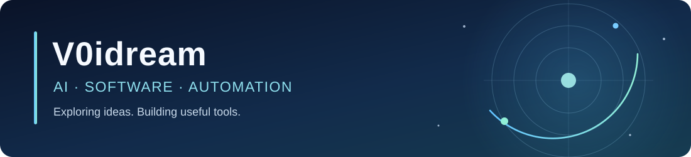

  

  
  
  

  Independent developer building practical software, experimenting with AI-assisted workflows, and turning ideas into usable tools.

## ✦ Featured project

<table>
<tr><td>
<h3><a href="https://github.com/V0idream/EvidenceWeave">EvidenceWeave</a></h3>

A <strong>local-first evidence review workbench</strong> that helps identify potentially supporting or conflicting statements across case materials. Findings remain traceable to source excerpts and PDF pages, with human verification built into the workflow.

<code>React</code> · <code>TypeScript</code> · <code>FastAPI</code> · <code>Ollama</code> · <code>PDF.js</code>

</td></tr>
</table>

## Selected projects

<table>
<tr>
<td width="50%" valign="top">
<h3><a href="https://github.com/V0idream/OrbitWheel">OrbitWheel</a></h3>

A configurable radial launcher for Windows, with keyboard shortcuts, gestures, and a Fluent-style settings interface.

</td>
<td width="50%" valign="top">
<h3><a href="https://github.com/V0idream/QuickBar">QuickBar</a></h3>

An Android accessibility overlay for reusable text shortcuts, clipboard actions, and lightweight automation.

</td>
</tr>
<tr>
<td width="50%" valign="top">
<h3><a href="https://github.com/V0idream/Jianying-Agent-Automation">Jianying Agent Automation</a></h3>

AI-assisted workflows for generating editable Jianying projects and automating exports on Windows.

</td>
<td width="50%" valign="top">
<h3><a href="https://github.com/V0idream/TaskbarNova">Taskbar Nova</a></h3>

A desktop spaceship exploration game with autonomous navigation, tactical combat, and ship customization.

</td>
</tr>
</table>

## Toolbox

**Languages** &nbsp; `Python` · `TypeScript` · `Kotlin` · `C#`

**Tools & frameworks** &nbsp; `React` · `FastAPI` · `Jetpack Compose` · `WinUI 3`

**Interests** &nbsp; AI tooling · local-first apps · anime & games

## 🏆 Achievements

  

  These activity trophies are generated from public GitHub data. Official GitHub achievement badges appear on the <a href="https://github.com/V0idream">profile sidebar</a> when enabled.

## GitHub activity

  <picture>
    <source media="(prefers-color-scheme: dark)" srcset="https://github-readme-stats.vercel.app/api?username=V0idream&amp;show_icons=true&amp;hide_border=true&amp;theme=github_dark" />
    
  </picture>

### Contribution snake

  <picture>
    <source media="(prefers-color-scheme: dark)" srcset="https://raw.githubusercontent.com/V0idream/V0idream/output/github-snake-dark.svg" />
    
  </picture>

## Connect

[**Email**](mailto:v0idream@163.com) · [**Coolapk**](https://www.coolapk.com/u/3597697) · [**Support my work**](https://github.com/V0idream/V0idream/blob/main/docs/support.md)

软件开发需求与合作交流，欢迎通过邮箱或酷安私信联系。喜欢某个项目的话，点一个 Star 就是很好的支持。
